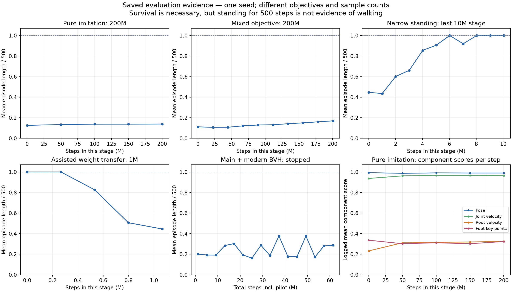

**Dijagnostika šest grana — 11. oktobar 2026.**

> Istorijski pregled. Aktuelno stanje oporavka je u
> [PROJECT_STATUS_RECOVERY.txt](PROJECT_STATUS_RECOVERY.txt), a najnovije kontrolisano
> poređenje u [izveštaju faze 6C](PROJECT_RECOVERY_PHASE6C_2026-10-12.md).
> Ispravljeno je više grešaka reference; stabilan naučen hod još nije potvrđen.

Preporuka je da razvoj nastavimo iz `project_v2_refrences_only`, uz selektivno
prenošenje popravki iz `experiment/v21-stable-baseline`. Stable grana nije za
otpisivanje: donela je dokaz stabilnog stajanja, ispravku vremenske konzistentnosti
reference, popravku evaluatora i korisne dijagnostike. Nije donela naučen hod.
`experiment/main-modern-bvh` treba sačuvati kao dokumentovan neuspešan eksperiment
ove konkretne integracije; njen rezultat ne dokazuje da noviji BVH ne valja.

Najvažniji nalaz je da smo nekoliko puta menjali sam problem koji treniramo.
Uspešan v16 kontroler, aktuelni `main` v17, v21 imitacija i v22 stajanje nisu ista
kontrolna postavka. Uz to postoje konkretne greške u vremenu reference, skaliranju
nagrade i koordinatnim sistemima. Dosadašnji podaci ne izdvajaju jedan jedini uzrok
neuspeha, ali dovoljno jasno određuju šta treba proveriti pre sledećeg dugog run-a.

Pregled je obuhvatio šest lokalnih Git grana, 172 sačuvane konfiguracije runova i
1.159 zapisa evaluacije. Analiziran je i lokalni izvorni kod DeepMimic-a i MimicKit-a.
Izvršene su male, determinističke MuJoCo provere mernih formula; novi trening ili
novi policy rollout nisu pokrenuti. Ranije korisnikovo vizuelno zapažanje da +285
checkpoint ne hoda uzeto je kao opažanje korisnika, a ne kao video koji sam sada gledao.

**Šta predstavlja svaka grana**

| Grana i pregledani commit | Šta predstavlja | Šta je dokazano | Preporuka |
| --- | --- | --- | --- |
| `main` — `33eaa1f` | Istorija uspešnog joystick kontrolera; današnji default je v17 | Arhivirani v16 checkpointi imaju hod i dobru stabilnost, uz probleme prirodnosti | Sačuvati tačan v16 checkpoint, XML i config kao kontrolni primer |
| `backup/with-7f1294e-before-test` — `de5cc52` | Stariji snimak SMPL/MimicKit razvoja, predak project-v2 | Popravke opsega akcija, bez nezavisno potvrđenog novog hoda | Arhiva i poređenje; nije dodatna potvrđena metoda |
| `project_v2_refrences_only` — `8b4d442` | Glavna BVH/SMPL/DeepMimic razvojna linija | Retargeting, RSI, reference observacije, reward i alati postoje; dugi runovi ne hodaju | Osnova za nastavak nakon prenosa potvrđenih popravki |
| `experiment/v21-stable-baseline` — `cd6557c` | Potomak project-v2; izolovani tracker, stajanje i prenos težine | Stabilno stajanje; mali potpomognuti transfer; nekoliko stvarnih popravki | Zadržati rezultate i birati promene po funkciji; ne preuzimati sve podrazumevane postavke |
| `experiment/main-modern-bvh` — `a6ca23d` | Grana direktno sa današnjeg main-a, sa novijim BVH adapterom | Integracija radi; pregledani checkpoint ne hoda; zaustavljeno na 61,36M sačuvanih ukupnih koraka | Arhivirati nalaz, sačuvati adapter i proveru limita |
| `lets_call_it_dave` — `0cd3da8` | Posebna linija sa AMP, curriculum i goal kodom | Njen izveštaj navodi `PHASE1_EXPERIMENTS_NOT_RUN` i nula evaluiranih seed-ova | Potencijalni izvor koda, ne dokaz da AMP već radi |

Odnos grana je: main → istorijska imitation linija → backup → project-v2 → stable.
Main-modern i lets_call_it_dave odvajaju se od main-a. To nisu šest nezavisnih
eksperimentalnih potvrda. U ovom pregledu nijedna grana nije obrisana ili promenjena.

**Prvi eksperimentalni problem: nismo reprodukovali tačan sistem koji je hodao**

Istorijski checkpoint P08 koristi `trainfast_v16`, `legacy_action_prior=true`,
512 trening okruženja i nastavak već naučenog P05 checkpointa. P05 je i sam
nastavak ranijeg treninga i treniran je bez ERFI/domain randomization; P08 ih
uključuje tek u kasnijoj fazi. Broj koraka u poslednjem folderu zato nije ukupno
iskustvo ove politike.

Arhivirani `analysis_outputs/policy_metrics.csv`, red P08/IN_DISTRIBUTION, beleži
12 trial-ova, 6.000 koraka, nula padova i tracking RMSE 0,1618. Beleži i foot-slip
metriku oko 0,164 m/s. To podržava opis „hoda, ali neprirodno“. To su istorijske
metrike, ne nova evaluacija u današnjim dependencies, i kvalitet njihovih izvedenih
brzina treba ponovo proveriti posle nalaza o koordinatnim sistemima.

| Svojstvo | Istorijski P08 | Main-modern eksperiment |
| --- | --- | --- |
| Model | v16 | v17 |
| Akcije/posturalna pomoć | `legacy_action_prior=true`; širi opseg nogu | `false`; uži opsezi po zglobovima, dodatne posturalne kazne |
| Početak | Nastavak P05, koji već hoda | Novi pilot 1,146M, pa nastavak |
| Perturbacije | Uvedene nakon prethodnog treninga | ERFI i DR uključeni od pilota |
| Motion skup | Deset BVH izvora | Jedan izvor, tri izdvojena ciklusa |
| Broj train/eval okruženja | 512 / vidi sačuvani config | 256 / 8 |

Razlika v16/v17 nije samo ime: menjaju se joint limits, damping, armature i
frictionloss. Npr. gornja granica hip_z ide sa 100° na 60°, a opseg kolena i njegovo
prigušenje takođe su izmenjeni. `legacy_action_prior` utiče na opseg akcija i na
aktivnost posturalnih nagrada/kazni. Ne treba ga automatski izjednačiti sa
proceduralnom pomoći iz kasnijeg v22 curriculuma.

Testovi main-modern grane dokazuju vernost kodu `main@33eaa1f`. Ne dokazuju vernost
konfiguraciji istorijskog uspešnog checkpointa. Raniji opis eksperimenta kao
„isti sistem koji je hodao, samo bolji BVH“ zato je bio previše jak. Ovo je propust
u postavljanju eksperimenta koji treba priznati i ispraviti u sledećem poređenju.

Dokazi: sačuvani P08/P05 `config.json`, v16/v17 XML; `main:config.py:14`,
`main:biomechanics_env.py:365` i deo rewarda oko 989; istorijski commit `72467cb`.
Tačne putanje P08/P05 nalaze se u tabeli važnih checkpointa na kraju.

**Šta pokazuju završeni i zaustavljeni trening runovi**

| Run, lokalni koraci | Poslednja prosečna epizoda / 500 | Zaključak koji podaci podržavaju |
| --- | ---: | --- |
| `20260817_0133_classic_200m...`, 200,049M | 69,594 | Pure imitation nije naučila održiv hod ni uz veliki budžet |
| `20260817_1051_guided_mixed_aggressive_200m...`, 200,540M | 85,031 | Promenjen/mixed cilj nije rešio problem |
| `20260818_1607_guided_mainbackbone_dm04...`, 20,275M | 70,000 | Task backbone + 0,4 imitation bonus nije dao proboj |
| `20261008_1823_v21_task_only_baseline...`, 10,138M | 500 | Model i PPO mogu da nauče stajanje bez reference |
| `20261009_0824_v21_forward_bootstrap...`, 10,240M nastavka | 500 | Stabilnost ostaje, ali ranija fiksna provera brzine je praktično nula |
| `20261009_1508_reference_tracker_inplace_residual010...`, 0,205M | 117 | Mali napredak sa početnih 103,75; još pada |
| `20261009_2241_v22_narrow_stand_continue10m...`, 10,035M nastavka | 500 | Usko stajanje naučeno posle ukupno oko 20M kroz tri faze |
| `20261010_0727_v22_weight_transfer_curriculum...`, 1,065M | 222,625 | Potpomognuta početna politika izdrži 500, kasnije evaluacije se pogoršavaju |
| Main-modern, 60,211M nastavka + 1,147M pilot | 143,250 | Poslednja evaluacija pada u 7/8 epizoda; budžet 80M nije završen |

U pure 200M run-u poslednji per-step pose score je 0,990, joint-velocity score
0,964, root-velocity score 0,324, a foot-key score 0,323. U mixed 200M run-u vrednosti
su 0,991 / 0,976 / 0,479 / 0,156. To je ključni obrazac: visok skor lokalnih zglobova
koegzistira sa lošim kretanjem tela i stopala i kratkim epizodama.

Reward vrednosti između ovih redova nisu uporedive: menjani su cilj, clipping,
terminalne kazne i dužina epizoda. Pozitivna zbirna nagrada ne znači da je hod
uspešan. „Najbolji step 0“ u nastavku treninga znači ulazni checkpoint sa novom
konfiguracijom, a ne novi naučeni rezultat.



Grafik prikazuje tačke iz logova, bez izmišljenih intervala pouzdanosti. Horizontalna
osa je lokalni brojač tog run-a, osim main-modern panela koji uključuje pilot.
Jedan seed i mali broj eval epizoda ograničavaju zaključke o varijansi.

**Potvrđeni problemi u project-v2 koje povratak na tu granu vraća**

1. **Brzine reference su četiri puta usporene, položaji nisu.** U IK putanji
   `8b4d442:biomechanics_env.py:798` prvo se računaju brzine iz položaja, zatim na
   803–818 množe sa 0,25, zajedno sa root brzinama. Sat reference i frame times
   nastavljaju normalno. Ako se položaj menja brzinom 1 rad/s, velocity target je
   0,25 rad/s: policy ne može istovremeno savršeno pratiti oba zahteva. To važi za
   reference sa IK targetima; ne treba ovu tvrdnju širiti na putanje koje ne ulaze
   u taj uslov. Stable uklanja skriveno skaliranje i vezuje speed scale za frame
   times i izvedene brzine (`cd6557c:biomechanics_env.py:812`, 926).

2. **Kopirani koeficijenti MimicKit rewarda rade nad drugačije definisanom greškom.**
   Project koristi `mean((q - q_ref)^2)` preko 18 scalar hinge DOF-ova, uz
   `exp(-0.25 * error)`; brzine imaju sličan mean i koeficijent 0,01.
   MimicKit koristi težinski zbir ugaonih quaternion grešaka zglobova i zbir
   grešaka brzina. To nije numerički isti reward. Jedan zglob pogrešan za 20° u
   našem primeru još dobija pose score 0,9983; svih 18 zglobova pogrešnih za 20°
   dobija 0,9700. Zato „pose=0,99“ ne potvrđuje tačan hod.
   Kontrolisano poređenje istih 18 hinge grešaka sa običnim zbirom daje 0,5779
   za svih 18×20°. To nije doslovan MimicKit humanoid rezultat, jer on ima drugačije
   zglobove i težine; primer izoluje efekat `mean` naspram `sum`.
   Izvori: `8b4d442:biomechanics_env.py:3188`; lokalni MimicKit
   `mimickit/envs/deepmimic_env.py:795`, commit `2ed1e6c`, odnosno
   [izvorni MimicKit reward](https://github.com/xbpeng/MimicKit/blob/2ed1e6c093bb0829f55d33cb4f7a1731cfe6cb69/mimickit/envs/deepmimic_env.py#L795).

3. **Ugaona brzina root-a se ponovo rotira iako je već lokalna.** Formula je
   `R_thorax.T @ qvel[3:6]`. Native MuJoCo test na tačnom v21 XML-u daje stvarnu
   lokalnu brzinu `[0.4, 0.7, -0.2]`, a formula vraća `[0.4, -0.2, -0.7]` rad/s.
   Greška je oko 1,030 rad/s u ovom determinističkom testu. Ovo pogađa observacije
   i korišćenje ugaone brzine u zadatku. Greška postoji i na main-u, pa sama ne
   objašnjava zašto je stari kontroler hodao a novi ne. Policy može naučiti deo
   sistematske transformacije, što ne čini fizičko tumačenje signala tačnim.
   Izvor: `8b4d442:biomechanics_env.py:4140` i isti metod na main/stable.

4. **Položaj i brzina centra mase nisu isto što i položaj i spatial velocity tela.**
   Project maseno ponderiše `xpos`, a treba centre mase segmenata `xipos`.
   U sintetičkom a-pose testu to daje 12,53 cm greške u 3D, pretežno po visini.
   Stable ovu grešku položaja ispravlja: u istom testu greška je nula.
   Obe grane i dalje pogrešno maseno ponderišu linearni deo `cvel` bez pomeranja
   spatial velocity na centar mase svakog segmenta; u testu je greška 0,0285 m/s.
   I „pelvis linear velocity“ direktno iz `cvel` nije brzina početka pelvis frame-a;
   ovde je razlika mala, 0,00142 m/s, ali formula generalno zavisi od pogrešnog
   položaja tačke. Ne treba malu izmerenu razliku predstaviti kao dokazan glavni uzrok.
   Izvori: project 3292, 3533, 3540; stable 4074, 4082.

Važna razlika u uticaju: stari project COM položaj se koristi za dijagnostičku
visinu; na stable grani ispravljeni položaj ulazi i u COM-transfer reward.
`_center_of_mass_velocity` helper u pregledanim environment fajlovima nema pozivno
mesto, pa njegovu grešku ne pripisujem direktno PPO rewardu. Isti pogrešan postupak
se, međutim, koristi u dynamics-audit alatu za capture-point procene. Pogrešna
pelvis brzina ulazi u root-velocity poređenje. Naziv `dm_com` dodatno zavara:
`8b4d442:biomechanics_env.py:3274` vraća root-velocity reward pod starim ključem
`com`; to nije nezavisna ocena stvarnog centra mase.

Native provere koriste Jacobian puta qvel i centralne razlike položaja posle
`mj_integratePos`. Dva nezavisna očekivana rezultata slažu se do približno
2e-10 m/s. XML SHA256 je `125b4b1285e44ea7ddd53f2b8713dcab2300079e95c825c4139c639589de4c87`,
isti kao u manifestima gore navedenih v21 runova. Ovo su proverljivi kontraprimeri
mernim formulama, ne merenje prosečne greške tokom treninga ili dokaz koliko bi
popravka poboljšala hod. Relevantni zvanični izvor je
[MuJoCo API za brzine objekata i integraciju položaja](https://mujoco.readthedocs.io/en/stable/APIreference/APIfunctions.html#mj-objectvelocity),
uz instalirani MJX `smooth.py:462` i `support.py:156`.

**Zašto trenutni project-v2 nije verna reprodukcija DeepMimic/MimicKit postavke**

Na HEAD-u project-v2 podrazumevan je `deepmimic_reward_mode="mixed"`:
task reward + 0,40 × imitation reward (`config.py:742`,
`biomechanics_env.py:2875`). Pure putanja postoji i trenirana je u
200M eksperimentu, tako da ne treba ceo istorijski neuspeh pripisati mixed režimu.

Razlike u odnosu na lokalni MimicKit obuhvataju scalar-hinge mean reward,
drugačiji model i kontaktni sistem, residual akcije oko reference umesto njegovih
absolute PD targeta, smoothing, drugačiju distribuciju akcija i PPO raspored.
MimicKit konfiguracija ima fiksni action std 0,05; project-ov Brax `init_noise_std`
nije isto što i garantovano fiksni std.
[Pregledana MimicKit PPO konfiguracija](https://github.com/xbpeng/MimicKit/blob/2ed1e6c093bb0829f55d33cb4f7a1731cfe6cb69/data/agents/deepmimic_humanoid_ppo_agent.yaml).
RSI i future-target observacije već postoje
u project-v2, pa njihovo „dodavanje“ nije odgovor na aktuelni kvar.

U project-v2 pose termination je po defaultu isključena, a fizički prekid prati
visinu, nagib i NaN. Na pregledanom v21 XML-u ne-stopalni geometrijski kontakti su
isključeni, pa nije implementirana ista zabrana pada na druge delove tela kao u
MimicKit postavci. To olakšava loše međustanje pre nego što termination reaguje.
Potrebna je jasna definicija pada; samo menjanje koeficijenta nagrade to ne rešava.

Mixed režim ponovo uzorkuje joystick komande nezavisno od fiksne motion reference.
To može stvarati sukob između zahteva za bočnim/obrnutim kretanjem ili okretanjem
i imitacije prednjeg hoda. Takvi meki ciljevi mogu imati kompromisno rešenje, ali
ova postavka nije izolovan test praćenja jedne reference. Prvo treba saznati da li
kontroler može pratiti jedan hod pri brzini koju taj hod stvarno predstavlja.

**Šta stable grana stvarno vredi**

Stabilno v21 široko i kasnije v22 usko stajanje jesu korisni rezultati. Pokazuju da
PPO, kontakti i aktuatori mogu da izgrade stabilnu politiku na tom modelu. Uski
neutralni stav smanjuje razmak stopala sa približno 52,9 cm na 21,3 cm, prema
sačuvanim geometrijskim dijagnostikama. To je korisna promenljiva za testiranje
prenosa težine, a ne dokaz da je anatomski „nemoguće“ hodati iz šireg stava.

Mali reference tracker sa residual scale 0,10 napreduje sa 103,75 na 119,875 koraka
u najboljoj evaluaciji, pa završava na 117. To je skroman pozitivan signal učenja.
Budžet oko 200k nije dovoljan za tvrdnju da ova varijanta nikad ne može naučiti;
rezultat ipak nije tracker koji prelazi više dugih ciklusa stabilnog hoda.

Curriculum sa target fraction 0,125 i procedural prior 0,25 na step 0 održava
500/500 i oko 1,9 cm COM greške. Posle 1,065M završava na 222,625/500 i oko 13,6 cm
greške. To podržava nalaz da u toj postavci fine-tuning degradira početno ponašanje.
Ne dokazuje da je sam PPO algoritam neispravan: promenjeni reward, bias početne
politike, optimizer restart, veličina update-a i mali eval uzorak nisu odvojeni.
Nije potvrđen potpuni prenos težine sa odizanjem slobodnog stopala.

Preneti vredi sledeće:

- Usklađeno vreme reference i uklanjanje skrivenog ×0,25.
- Rekonstrukciju sačuvanog EnvConfig-a u evaluatoru; raniji videi sa oznakom
  `evaluator_config_bug` nisu pouzdane procene baš tih checkpointa.
- Ispravku COM položaja na `xipos`, uz dodatnu novu ispravku njegove brzine.
- Razdvojene task/reference presete, fiksne eval komande i fizičke metrike.
- Konfigurabilan neutralni stav, warmup i alate za keypose/limit provere.
- Razdvajanje Windows CPU i WSL CUDA dependencies.
- Stabilni narrow-stance checkpoint kao poseban kontrolni primer.

Ne bih automatski prenosio sve COM/procedural rewarde, assisted priore i sve
PPO override-e u čisti imitation eksperiment. Svaka od tih stavki menja zadatak.
Veliki commit `cd6557c` sadrži i popravke i eksperimentalne promene, pa je prenos
po funkciji/fajlu prikladniji od preuzimanja celog commita bez pregleda.

**Šta main-modern rezultat znači**

U modern integraciji nalaze se dodatni konkretni problemi:

- Originalni main maskira referencu na `hip_x`, `knee_z`, `ankle_y` za obe noge.
  Sagittalni `hip_z` novijeg retargetinga nije direktno nagrađen niti prosleđen kao
  reference-target observacija. Project-v2 ima drugi imitation put; ovaj nalaz
  ne treba pogrešno primeniti na njega.
- Audit nalazi 9,2–12,2% joint-target uzoraka izvan `default ± action_scale` opsega.
  XML actuator limits prolaze, ali to nije isti uslov. Ovo znači da te motor
  ciljeve politika ne može direktno zadati; ne dokazuje da dinamika nikad ne može
  dovesti zglob u te položaje.
- Adapter računa root i foot informacije, ali main imitation reward koristi
  samo joint qpos/qvel. Lepši full-body preview ne znači da policy uči isti prikaz.
- Post-IK stability blending ponovo pomera noge nakon fitovanja stopala. U
  pregledanom auditu postoji loop pose gap 0,049–0,138 rad i near-ground foot-speed
  p95 0,261–0,606 m/s. Geometrijski prag visine stopala nije dokaz fizičkog stance-a.

Izvori za ovu integraciju: `biomechanics_env.py:252`, `:420`, `:923`, `:1193`;
`bvh_retargeting.py:175`; `artifacts/main_modern_bvh_audit.json`.

Najbolji reward +285,146 pripada lokalnom checkpointu `000048168960`:
188,375/500 koraka, padovi 6/8. Poslednji sačuvani `000060211200` ima +147,664,
143,25/500, padovi 7/8. Sa pilotom je sačuvano 61.358.080 ukupnih koraka.
Run je zaustavljen na korisnikov zahtev i nije završen eksperiment od 80M.

Ovaj rezultat opravdava odustajanje od daljeg neizmenjenog treninga ove postavke.
Ne opravdava zaključak da novija referenca ne može pomoći istorijskom v16
kontroleru: takav kontrolisan A/B nije urađen. Vrede adapter, odvojeni stari
loader, motion-clock popravke, reachability audit i operativne popravke čuvanja
statusa. Treba sačuvati i negativan rezultat sa njegovim ograničenjima.

**Dva ranija zaključka koja moramo ublažiti**

Prethodni dokumenti uslovljavaju svaki RL pokušaj time da čisti free-root PD replay
prethodno stabilno izvede tri ciklusa. To je koristan dijagnostički test, ali nije
teorijski preduslov DeepMimic-a. Naučena politika treba da bira motor targete i
koriguje balans, a ne samo da reprodukuje q_ref kao PD komandu. Originalni rad
ispituje i drugačiju morfologiju/fiziku i reference koje nisu savršeno fizički
tačne. Zato pad PD replay-a nije dokaz da RL ne može naučiti približan prirodan hod.
[DeepMimic, izvorni rad, odeljci 5 i 10.3](https://xbpeng.github.io/projects/DeepMimic/DeepMimic_2018.pdf).

Sačuvani inverse-dynamics nalazi 14,51×, odnosno u drugim varijantama do oko 69×,
jesu jaka upozorenja za tačno zadatu putanju pod tom pretpostavkom kontakata.
Nisu dokaz da humanoid ne može hodati. Treba odvojeno proveriti unactuated-root
residual force, kontaktne pretpostavke i računanje qacc, posebno oko loop spoja.
Capture-point procenti iz starih audit-a dodatno zavise od pogrešne COM brzine
i pojednostavljenog modela balansa. Njih ne treba tretirati kao konačnu presudu.

I oznaka invariant PASS ima granice: audit dozvoljava seam do 0,20 rad i
penetraciju do 15 mm. Zabeleženi PASS ima seam 0,0515 rad i penetraciju 5 mm.
Provera stored-qvel naspram iste `np.gradient` konstrukcije ne proverava potpuno
derivat runtime interpolacije, root angular velocity ili glatkoću preko spoja.
Zato „kinematika potpuno rešena“ nije opravdan zaključak tog testa.

**Gde je prvo crveno svetlo i kojim redom nastaviti**

| Nivo | Trenutno stanje | Sledeća provera koja razdvaja uzroke |
| --- | --- | --- |
| Izvršavanje i checkpointi | Funkcioniše; evaluator je imao popravljenu config grešku | Kratka reprodukcija istog checkpointa uz eksplicitne model/config potpise |
| Osnovna kontrola modela | Stajanje dokazano; istorijski v16 hod postoji | Fiksni kontrolni rollout istorijskog v16 i narrow-stance politike |
| Definicija fizičkih veličina | Crveno: gyro, COM velocity, stari COM položaj | Jacobian/finite-difference testovi na stvarnom XML-u |
| Vreme i geometrija reference | Project-v2 vraća ×0,25 bug; stable samo delimično prolazi | Runtime q/dq, quaternion, loop i kontaktna provera istog clip-a |
| Reward i cilj | Crveno: slaba diskriminacija, različite mixed postavke | Reference/standing/wrong-phase poređenje komponenti i rewarda |
| Jedan naučeni gait tracker | Nije ostvaren | Jedan čist forward clip, jedan model i jedan jasan cilj |
| Joystick i prirodnost | Prerano za zaključak | Uvesti nakon potvrđenog trackera; kontrolisati sukob sa referencom |

Konkretan predlog za nastavak:

1. Napraviti novu recovery granu sa `project_v2_refrences_only@8b4d442`, sačuvati
   postojeće grane kao arhivu. U novi run zapisivati Git SHA, diff/clean status,
   XML hash, hash obrađene reference, resolved EnvConfig/PPOConfig i parent
   checkpoint. Današnji config-i često nemaju dovoljan potpis da rekonstruisemo
   tačan kod run-a samo po datumu.
2. Preneti potvrđene popravke vremena i evaluatora iz stable, ispraviti merne
   veličine i dodati male regresione testove za njih. Stare checkpoint-e i dalje
   evaluirati sa starom semantikom ako im se ne radi eksplicitna migracija;
   promena gyro observacije menja ulaz naučene politike.
3. Fiksirati v21/noarms XML i jedan `02_01` ciklus, bez ERFI/DR i joystick zadatka.
   Proveriti ceo lanac od runtime reference preko reset-a do PD motor targeta.
   Pozicije, brzine i sat moraju opisivati istu putanju. Validirati više faza
   reset-a i više loop prelaza, uz fizičke jedinice i stvarni contact signal.
4. Napraviti reward test sa exact reference, stajanjem, pogrešnom fazom, zamenjenim
   nogama i klizanjem stopala. Proveriti amplitudu i svaku komponentu, ne samo
   da je exact score blizu 1. Objediniti quaternion/hinge definiciju zglobnih
   grešaka; koeficijente ne preslikavati bez njihove normalizacije.
5. Zatim trenirati jedan izolovan tracker uz unapred dogovoren ozbiljan budžet,
   npr. 80M. Kratak pilot proverava integraciju i rane kvarove; 1M nije merilo
   konačne sposobnosti. Startovati od reference stanja različitih faza; dodatno
   meriti fixed-start i višeciklusni rollout. PD replay koristiti kao poređenje
   i dijagnostiku, a ne kao apsolutnu zabranu RL testa.
6. Uspeh definisati pre run-a: trajanje epizoda, padovi, brzina/displacement,
   naizmenični stance/swing, foot clearance/slip, greške root-a i stopala,
   saturacija aktuatora i video. Predlog prvog gate-a je 10 s bez pada u većini
   fiksiranih evaluacionih slučajeva, stvarni koraci i brzina koja odgovara klipu;
   brojčane tolerancije postaviti po kadenci/veličini tog klipa. Periodično koristiti
   isti skup, npr. 32 faze/seed slučaja, uz poseban held-out skup za završnu procenu.
7. Tek tada dodavati joystick, mali raspon brzine/smera i robustness. Ako jedan
   tracker i dalje ne uspe, odvojeno testirati action parametrizaciju/PD autoritet,
   obradu kontaktnih faza i trening stabilnost. Svaki test treba da promeni jednu
   porodicu uzroka uz kontrolnu varijantu.

Za originalnu ideju „uspešan walker + bolji BVH“ postoji odvojena, legitimna
eksperimentalna putanja: prvo reprodukovati P08 na njegovom v16/model/action
config-u, zatim uporediti nastavak sa starom i novom referencom pod istim
uslovima. Zamena observacije/reference može i tada pomeriti distribuciju ulaza;
zato kontrolni nastavak sa starom referencom mora postojati.

AMP ostaje smislen kasniji kandidat za joystick i stil jer ne zahteva praćenje
jednog tačnog frame-a u svakom trenutku. Ipak, prikaz i kvalitet demonstracija
ostaju bitni, a lets_call_it_dave tek treba da prođe eksperimentalnu proveru.
Ne bih sada otvarao još jedan veliki AMP razvoj pre nego što zatvorimo potvrđene
greške i reprodukujemo jedan kontrolni primer.
[Zvanični MimicKit kod i opisi metoda](https://github.com/xbpeng/MimicKit).

**Važni checkpointi i dokazi koje treba sačuvati**

| Oznaka | Putanja |
| --- | --- |
| Istorijski P05 walker | `runs/successful/biomechanics_noerfi_nodr_ref_bvh_v10_standard_resume3_from_29286400_100m_accurate_ppo_BiomechanicsHumanJoystickStandard_20260625_0018_100m_seed7_rew_758p4744_best_1029p5856_s/checkpoints/000087040000` |
| Istorijski P08 walker | `runs/successful/biomechanics_ref_bvh_v10_best87040_erfi_dr_180m_accurate_ppo_BiomechanicsHumanJoystickStandard_20260625_2136_180m_seed7_running/checkpoints/000127795200` |
| Stable narrow stance | `runs/20261009_2241_v22_narrow_stand_continue10m_V1_steps-10m_reward-1304p3926_s/checkpoints/000010035200` |
| Najbolji mali residual tracker | `runs/20261009_1508_reference_tracker_inplace_residual010_02_V1_steps-200k_reward-296p5762_s/checkpoints/000000102400` |
| Main-modern najbolji po rewardu | `runs/20261010_1204_bio_main_modern_bvh_80m_total_78m8_running/checkpoints/000048168960` |
| Main-modern poslednji sačuvani | `runs/20261010_1204_bio_main_modern_bvh_80m_total_78m8_running/checkpoints/000060211200` |

Istorijske tekstove `docs/debug_walk/FINAL_WALK_FAILURE_AUDIT.md`,
`docs/EXPERIMENT_STAGES.md`, `docs/MOTION_METHOD_REVIEW.md` i `PROJECT_STATUS.txt`
treba čitati uz datum i commit: sadrže korisne tragove, ali i zastarele statuse i
prejake zaključke o PD-u/dinamičkoj nemogućnosti. Nisu zamena za log i numeričku proveru.

Detaljni novi dokazi su u `analysis_outputs/branch_diagnosis_20261011/`:

- `snapshot.json`: pregledani commit-i, broj runova/evaluacija i ograničenja.
- `run_inventory.csv`: konfiguracije, best/last/first metrike i linije logova.
- `eval_history.csv`: svi izdvojeni zapisi evaluacije.
- `measurement_probes.json`: ulazni test, XML hash i kvantifikovane greške formula.
- `training_evidence.png` i `.pdf`: grafici sačuvanih evaluacija.

Ponovljiva Windows Git Bash komanda za dokaze:

```bash
./.venv-win/Scripts/python.exe tools/summarize_branch_evidence.py --plot
./.venv-win/Scripts/python.exe tools/probe_branch_invariants.py
```

Ove komande čitaju runove/Git objekte i upisuju izveštaje; ne treniraju politiku.
CSV dokazi su po postojećem `.gitignore` pravilu `*.csv` ignorisani. Dokument,
skripte, JSON provere i PNG/PDF grafik nisu ignorisani i mogu se commitovati.
Za nezavisnu arhivu treba posebno sačuvati i CSV rezultate, konfiguracije i
checkpointe, jer običan Git push ne uključuje ignorisane runove.

Preporučena odluka je da sačuvamo sva tri istraživačka rezultata: istorijski hod,
naučeno stajanje i negativne imitation/integration eksperimente. Razvojni nastavak
treba da krene iz project-v2 sa proverljivim popravkama. Još nije opravdano tvrditi
da znamo jedan uzrok ili da bilo koja pojedinačna popravka garantuje prirodan hod.
