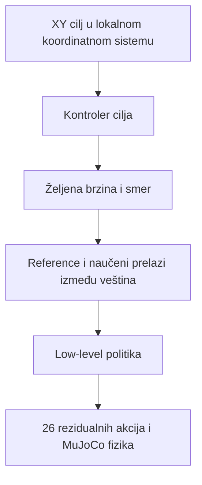

# Skills: pregled i prvi korak — 2026-11-05

Nastavak implementacije i komande za kontrolisano stand PPO poređenje opisani
su u [STAND_ABLATION.md](STAND_ABLATION.md). Fresh-critic opcija, smislen logging
i fizički checkpoint gate sada su implementirani. Pregled ispod beleži početno
stanje i neuspešne baselines, pre tog poređenja.

## Polazna tačka koju sam sačuvao

Napravio sam `skills_walking_with_anatomical_human_robot` od commita `2a6156e`.
Taj commit sam označio tagom `natural-walk-v1.0`. Finalni XML, BVH, checkpoint i
snimci ostaju u `prezentacija/5th_success_final_natural_walk`. Nisam menjao tu
arhivu ni grane natural-walk i joystick. Nisam koristio odbačeni
`bipedal-humanoid-bullet-avoidance` projekat.

## Šta sam proverio u kodu

| Nalaz | Posledica i odluka |
| --- | --- |
| `_is_pure_reference_imitation()` isključuje komande; evaluator radi isto. | Postojećoj politici ne mogu zadati stajanje komandom brzine nula. |
| Rezidualne akcije dodaju se na referentne zglobne uglove. | Nulta akcija i dalje reprodukuje hod dok se referenca pomera. |
| Referentni sat napreduje nezavisno od joysticka. | Za kočenje moram promeniti referentni pokret i njegove izvode dosledno, a zatim naučiti tranziciju. Zamrzavanje nasred koraka nije stand referenca. |
| Četiri buduće reference ulaze u observation. | Reset, reward, budući ciljevi i PD centar moraju govoriti o istom pokretu. |
| Actor ima 366 ulaza i 26 izlaza; critic ima 809 ulaza. | Mogu učitati postojeće težine, ali iste dimenzije ne dokazuju da politika ume novu veštinu. |
| Pure imitation reward ne nagrađuje dolazak na proizvoljnu XY tačku. | Za A→B moram dodati cilj u observation i poseban task reward. Sama velika imitation nagrada nije dokaz navigacije. |
| `step()` bez reference nije inicijalizovao pet arm metrika. | Popravio sam stvarni `KeyError`; regresija prati pravi reset i physics/reward graf. Finalni BVH hod nije koristio tu granu. |
| Brax checkpoint vraća actor, critic i normalizer; optimizer i brojač koraka počinju iznova. | Novi stand run tretiraću kao fine-tuning eksperiment, ne kao bit-identičan nastavak starog treninga. Pre treninga moram odlučiti da li zadržavam critic. |

## Prvi korak koji sam implementirao

Dodao sam `skills/stand.py`, opt-in preko `EnvConfig.locomotion_skill="stand"`
i `train.py --locomotion-skill stand`. Stari config bez ovog polja bira `walk`.
Trening i evaluator biraju isti tip okruženja.

Koristim neutralnu pozu istog anatomski podešenog modela. Jednofrejmna referenca
ima nulte zglobne i root brzine, nepokretan root i FK markere iz te iste poze.
Sat i faza su nula; dužina tog jednog frejma ne završava epizodu. Zadržao sam
rezidualne akcije, originalnu fiziku, svih 26 aktuatora i imitation reward.
Oznaka `reference_gait=bvh` ovde zadržava postojeći interfejs za reference;
stand režim **ne učitava BVH**, već beleži izvor `generated:neutral_stand`.

U `skills/stand_metrics.py` sam odvojio merilo uspeha od reward-a:

- brzina root-a u XY manja od 0,15 m/s;
- udaljenost od početne XY pozicije manja od 0,25 m;
- uspravnost torza najmanje 0,9 i visina najmanje 85% početne visine;
- oba đona dodiruju pod; konačne fizičke vrednosti, bez pada;
- svi uslovi važe neprekidno jednu sekundu, odnosno 50 koraka na 50 Hz.

Reset ne računa kao proteklo vreme. Svaki prekid briše dwell. Uspeh ne prekida
epizodu i ne donosi terminalni bonus. Za prihvatanje veštine tražiću i 500/500
koraka bez pada i uspešno završno zadržavanje, zatim dužu proveru i perturbacije.
Početni stand reset je za sada deterministička neutralna poza, bez robustnog
curriculuma ili walk→stand prelaza.

## Šta je fizički dokazano, a šta nije

Pokrenuo sam `tools/check_stand.py` sa punom gravitacijom i slobodnim root-om.
Referenca je nepokretna, brzine su nula i targeti su unutar kontrolnih limita.
Kratak MJX rollout prolazi bez greške, sa istim dimenzijama observation/action.

Konstantni PD ciljevi **ne održavaju dugotrajnu ravnotežu**: pad nastupa posle
148 koraka, odnosno **2,96 s**. Precizne vrednosti zapisujem u
`analysis_outputs/skills/stand_preflight.json`; kriterijum pada je isti prag
uspravnosti kao u runtime-u (0,25). To ne dokazuje da je stajanje nemoguće:
ovaj kontroler nema naučene povratne korekcije balansa.

Zamrznuti walking actor, na ovoj novoj stand referenci, pada posle **122/500
koraka = 2,44 s**. Maksimalni neprekinuti dwell je približno **1,04 s**, ali
završni dwell je nula. Rezultat beležim u
`analysis_outputs/skills/stand_walking_actor_probe.json`. To je jedna
deterministička početna situacija; ne predstavljam je kao statističku evaluaciju.

Ovo je razlog da stand treniram kao novu veštinu. Nisam ovim testom dokazao
ni naučeno stajanje, ni kočenje, ni A→B. Nisam pokrenuo dug PPO run.

## Arhitektura i naredni eksperimenti

Raniji dijagram sam dopunio ključnim uslovom: low-level sloj tek mora da nauči
odgovor na željenu brzinu i smer. Zamrznuti walking actor to trenutno ne ume.



1. **Stand:** kratko upoređujem fine-tuning walking težina sa učenjem stand-a
   od početka, uz iste fizičke uslove i budžet. Pratim padove, drift i dwell,
   a ne samo reward. Ne menjam zamrznuti walking checkpoint.
2. **Walk→brake→stand:** treniram prelaze sa više faza hoda i merim vreme i
   put kočenja. Ne spajam sirove izlaze dve politike bez provere stabilnosti.
   Uključujem walking epizode/provere da bih otkrio zaboravljanje hoda.
3. **Forward A→B:** dodajem lokalni cilj, rastojanje, progress i braking reward;
   počinjem ciljevima ispred robota na različitim udaljenostima. Uspeh tražim
   unutar 25 cm, ispod 0,15 m/s, uz jednu sekundu dwell-a i bez pada.
4. **2D i ciljevi iza:** uvodim skretanje, dosledno rotirane pozicije i brzine
   reference, zatim završni yaw kao zaseban zahtev.
5. **Povezani ciljevi:** proveravam više dolazaka bez resetovanja fizike.

U ovoj prvoj implementaciji stand reward ostaje imitation reward. Anchor drift
merim, ali još ne dodajem novi task reward/observation. Ako politika počne da
klizi uz visok reward, to je vidljiv neuspeh testa, ne završen stand rezultat.
Pre A→B moram izložiti cilj politici; trenutno pozicija cilja nije deo actor-a.

## Šta sam preuzeo iz radova

Iz [DeepMimic-a](https://xbpeng.github.io/projects/DeepMimic/) uzimam razdvajanje
imitation i task cilja, kao i potrebu da se veštine i njihovo ponašanje nauče.
Moj zaključak za ovaj repo je da najpre treba iskoristiti postojeći tracker,
umesto odmah menjati ceo algoritam.

[AMP](https://xbpeng.github.io/projects/AMP/) koristi adversarial motion prior
iz skupa pokreta, bez eksplicitnog zadavanja redosleda klipova. Razmatraću ga
kada bude potrebno više stilova i slobodnije task ponašanje; sada bi dodao
novu komponentu i novu obuku čiji doprinos ne bih mogao jasno da izdvojim.

[ASE](https://xbpeng.github.io/projects/ASE/) uči ponovo upotrebljive latentne
veštine za downstream zadatke. To podržava dugoročni smer arhitekture, ali
njegov veliki simulacioni budžet i drugačiji trening nisu gotov dodatak našem
jednom walking checkpoint-u. Više BVH klipova ne znači automatski bolje hodanje
niti aritmetičko usrednjavanje poza.

Trčanje, ustajanje i avoidance ostavljam za kasnije. Ne pokušavam da ih rešim
istovremeno sa prvim učenjem balansa u mestu.

## Reprodukcija

Iz korena repoa, u Windows Git Bash-u ili PowerShell-u:

```text
./.venv-win/Scripts/python.exe tools/check_stand.py --mjx-steps 3
./.venv-win/Scripts/python.exe tools/check_stand.py --mjx-steps 500 --policy --output analysis_outputs/skills/stand_walking_actor_probe.json
./.venv-win/Scripts/python.exe -m unittest discover -s tests -v
```

Prva komanda proverava PD držanje i tri MJX koraka. Druga učitava zamrznuti
actor samo za evaluaciju. Nijedna ne trenira, ne menja checkpoint i ne zahteva
Windows CUDA instalaciju. Prva kompilacija može trajati nekoliko minuta.

## Provera izmena

U punom suite-u proverio sam 361 test: 360 je prošlo, a jedan stari test je
očekivao da svako `EnvConfig` polje ide direktno u konstruktor. Prilagodio sam
ga jer `locomotion_skill` sada bira sam konstruktor, i dodao proveru učitavanja
starih i novih konfiguracija. Nakon toga svih 29 testova tog modula prolazi.
Stand testovi pokrivaju pravi MJX reset/step, buduće targete, shape kompatibilnost,
batch evaluator i dwell uslove. Ruff provera novih modula prolazi.

Proverio sam da arhiva finalnog hoda nema Git razlike u odnosu na tag i da
obe postojeće grane ostaju na svojim ranijim commit-ima. Ovim ne tvrdim da sam
ponovio celu četvoroseednu walking evaluaciju; njen zamrznuti rezultat nisam menjao.
